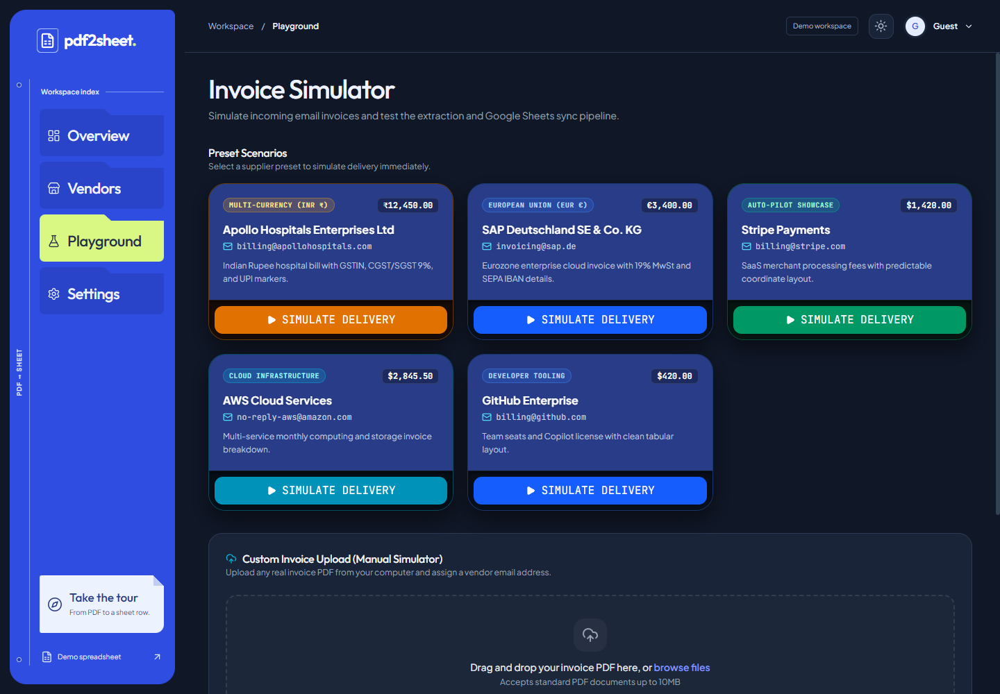

# PDF2Sheet

PDF2Sheet turns PDF invoices into records you can review, search, and send to Google Sheets. It remembers where fields appear on a vendor's invoices so the next document can reuse the same mapping.

## Features

- **Invoice intake.** Upload a PDF, sync a configured email inbox, or load a sample from the simulator.
- **Visual review.** Select text on the PDF to map fields such as the invoice number, date, and total. Preview the spreadsheet row before approval.
- **Vendor mappings.** Inspect the extraction rules the app has learned for each vendor and reuse them on later invoices.
- **Invoice register.** Search invoices, filter the review queue, compare vendor spend in a selected currency, and export records as CSV or JSON.
- **Google Sheets sync.** Connect a spreadsheet to receive approved invoice records.

## Stack & implementation

| Area | Technologies |
| --- | --- |
| Frontend | React 19, Vite 7, Tailwind CSS, TanStack Query, Framer Motion |
| Backend & database | Node.js, Express 5, MongoDB, Mongoose |
| PDF extraction | pdf2json and pdf-parse for PDF text, with pdf2json supplying page coordinates |
| Integrations | IMAP for email intake, Google Sheets API with OAuth 2.0, optional Groq features |

## How it works

1. **Bring in an invoice** through a PDF upload, an email attachment, or a sample in the simulator.
2. **Check the extracted fields.** PDF2Sheet can reuse a known vendor's coordinates or look for labels and values in the PDF. Review the result when a field needs attention.
3. **Approve the record.** The visual mapper can save corrected coordinates for later invoices. If you connected Google Sheets, approval can also append the invoice to the spreadsheet.

## Engineering highlights

- **Spatial extraction.** Vendor rules store the page and bounding box of a field, so the app can read the same area on an invoice with a matching layout.
- **Review in context.** The mapper keeps the original PDF, editable fields, and spreadsheet preview together while you verify values.
- **Guest workflow.** The API serves sample invoices from an in-memory store, so you can try the simulator and register without connecting a mailbox or spreadsheet.

## Screenshots

*Current interface with sample invoices. Click an image to view it at full size.*

| Invoice dashboard | Invoice simulator |
| :---: | :---: |
| [](docs/screenshots/dashboard.png) | [](docs/screenshots/simulator.png) |
| Upload an invoice, check the inbox, or follow the illustrated handoff. | Choose a sample supplier or upload a PDF to try extraction. |

## Run locally

Use Node.js 22 and npm. Set up MongoDB for persistent accounts and invoice data. The guest flow can run without a database.

```bash
git clone https://github.com/aavishkark/pdf2sheet.git
cd pdf2sheet
npm run install:all
```

Create the environment files with your own settings.

| File | Configuration |
| --- | --- |
| `backend/.env` | `PORT=5000`, `FRONTEND_URL=http://localhost:5173`, `MONGODB_URI`, and a random `JWT_SECRET` |
| `frontend/.env` | `VITE_API_URL=http://localhost:5000/api` |

For Sheets, set `GOOGLE_CLIENT_ID`, `GOOGLE_CLIENT_SECRET`, and `GOOGLE_REDIRECT_URI=http://localhost:5000/api/sheets/callback` in the backend and register that redirect URI with your Google OAuth client. For inbox sync, configure `IMAP_HOST`, `IMAP_PORT`, `IMAP_USER`, and `IMAP_PASSWORD`. Set `GROQ_API_KEY` to enable the optional AI features.

Run the API and frontend from the repository root in separate terminals.

```bash
# Terminal 1
npm run dev:backend

# Terminal 2
npm run dev:frontend
```

Open [PDF2Sheet locally](http://localhost:5173), select **Try as Guest**, and open **Playground** to try one of the bundled invoices. The API health check is at `GET http://localhost:5000/health`.

## Tests

The frontend tests cover guided-tour navigation and how the dashboard illustration responds to scrolling.

```bash
node --test frontend/src/utils/guidedTour.test.js frontend/src/utils/handoffScroll.test.js
npm run build:frontend
```

Built by [Avishkar Kamble](https://github.com/aavishkark).
